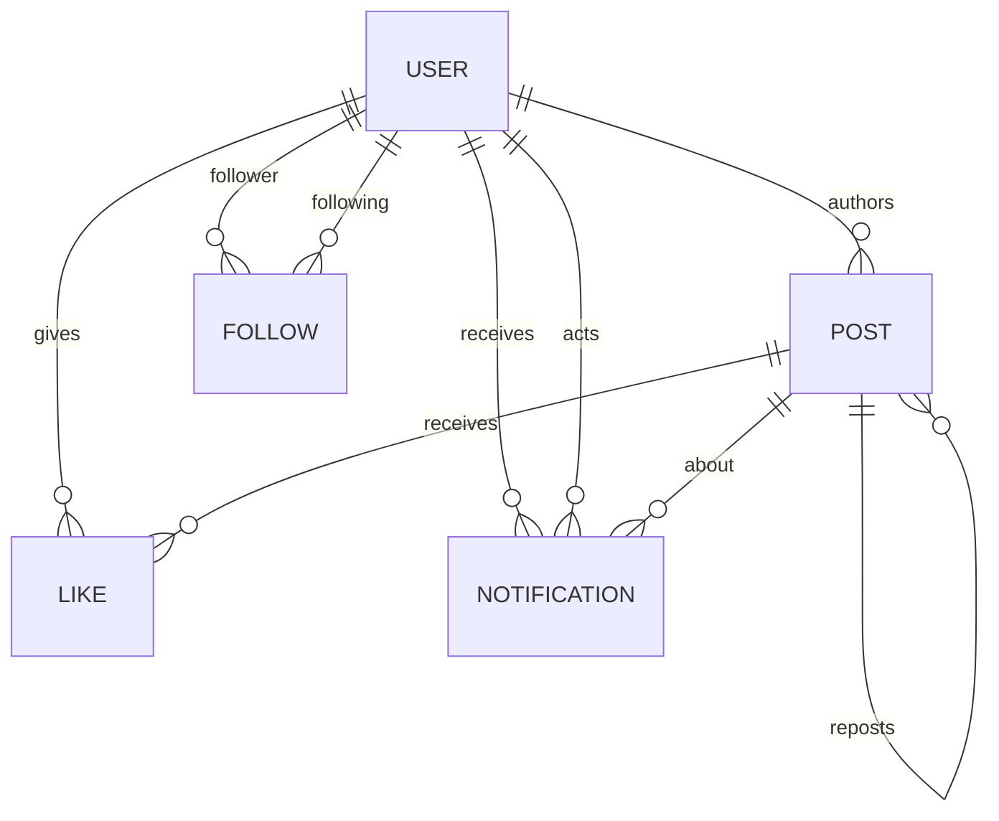

# Quill Case Study — Handoff Brief

> **Purpose of this file:** everything the writing agent needs to produce the final
> CSE302L case-study document. It contains the domain analysis, the data model,
> the ten queries, the expected results, execution instructions, screenshot
> requirements and a proposed document outline.
>
> **Do not put secrets in the final document.** The Atlas password and
> `BETTER_AUTH_SECRET` live only in `apps/web/.env`. Use placeholders such as
> `<password>` in any screenshot or code block.

---

## 0. Quick facts

| Item                  | Value                                                          |
| --------------------- | -------------------------------------------------------------- |
| Course                | CSE302L — Database Systems                                     |
| Assignment            | NoSQL database case study                                      |
| Domain                | Social media / microblogging (Twitter/X-style)                 |
| Project name          | **Quill**                                                      |
| Database              | MongoDB Atlas, database name `quill`                           |
| Data layer            | Prisma ORM 6.19.3 with the MongoDB provider                    |
| Application           | Next.js 16, tRPC, Better Auth, Bun, Turborepo                  |
| Deployed app          | `https://quill-post.vercel.app`                                |
| Repository            | `https://github.com/Siddhj2206/quill`                          |
| Demo login            | `demo@quill.dev` / `quill12345`                                |
| Query runner          | `bun run queries`                                              |
| Query source          | `packages/api/src/queries/` (one file per query)               |
| Current data snapshot | 50 users, 500 posts, 300 follows, 1,500 likes, 7 notifications |

The project is a working microblogging app, not a mock dataset. The ten
case-study queries are the same functions used by the app's Home, Explore,
Hashtag and Profile screens.

---

## 1. Assignment requirements and how Quill satisfies them

The brief requires:

1. Choose a domain.
2. Implement the database using a NoSQL/cloud database.
3. Execute at least 10 queries.
4. Answer 5 simple questions with query execution.
5. Answer 5 complex questions with query execution.
6. Submit a document with domain analysis, explanations, queries and execution
   screenshots.
7. Be ready to demonstrate the queries if asked.

Coverage:

| Requirement             | How Quill covers it                                                                                            |
| ----------------------- | -------------------------------------------------------------------------------------------------------------- |
| Domain chosen           | Social media / microblogging                                                                                   |
| NoSQL / cloud database  | MongoDB Atlas, accessed through Prisma's MongoDB provider                                                      |
| At least 10 queries     | S1–S5 (simple) and C1–C5 (complex), 10 total                                                                   |
| 5 simple questions      | S1 posts by user, S2 posts by hashtag, S3 latest posts, S4 followers, S5 user counts                           |
| 5 complex questions     | C1 home timeline, C2 trending hashtags, C3 suggested accounts, C4 engagement rate, C5 posting activity by hour |
| Populated data          | Deterministic seed: 50 users, 500 posts, 300 follows, 1,500 likes, 7 notifications                             |
| Execution evidence      | Run through `bun run queries`, MongoDB Compass or `mongosh`; screenshots still need to be captured             |
| Demonstration readiness | Every query is a real file in `packages/api/src/queries/` and is used by an app screen                         |

---

## 2. What the final document must contain

Produce a single coherent report, not a list of query dumps. A good structure:

1. **Title page** — course code, case-study title, student name/roll number,
   institution, date.
2. **Abstract / executive summary** — domain, database choice, dataset size,
   what the ten queries demonstrate.
3. **Domain analysis** — the social-media problem, stakeholders, workload,
   why NoSQL fits, scope and assumptions.
4. **System and database architecture** — application stack, Atlas deployment,
   how the app talks to MongoDB.
5. **Data model** — collections, fields, relationships, embedding vs referencing,
   indexes, denormalization, transactions and soft delete.
6. **Dataset** — how the data was generated, what it contains, demo account,
   limitations of synthetic data.
7. **Query methodology** — the difference between the five simple and five
   complex questions.
8. **Simple queries S1–S5** — each with question, query, result, explanation
   and screenshot.
9. **Complex queries C1–C5** — same, plus a short explanation of each pipeline
   stage.
10. **Insights** — what the results say about the domain, not just what the
    documents contain.
11. **Design tradeoffs, limitations and future work** — honest engineering
    analysis.
12. **Conclusion**.
13. **References**.
14. **Appendix** — full schema, index list, raw result snippets, screenshot index.

For every query section use the same pattern:

- **Question** (plain English).
- **Why it matters** (business/domain meaning).
- **Query** (mongosh-ready code block).
- **Execution result** (trimmed table or JSON).
- **Explanation** (what the stages do and why the result looks like that).
- **Screenshot** (figure with caption).

Do not paste 500 rows. Show the top few rows and state the total, or explain
that the result was truncated for readability. Put full output in the appendix
if needed.

---

## 3. Domain analysis

### 3.1 Domain and scope

The chosen domain is **social media**, specifically a text-first microblogging
platform. Users publish short posts, reply to posts, repost existing posts,
follow other users, like posts and receive notifications. The home feed is
built from the accounts a user follows. Explore surfaces recent posts,
trending hashtags and suggested accounts.

The case study models the core of that domain:

- **Identity and profile:** user account, handle, bio, follower/following/post
  counts.
- **Content:** original posts, replies and reposts.
- **Social graph:** directed follow relationships.
- **Engagement:** likes, replies and reposts.
- **Discovery:** hashtags, trending tags, suggested accounts and engagement
  ranking.
- **Notifications:** likes, reposts, replies, follows and mentions.

Out of scope: media uploads, direct messages, advertising, moderation queues,
recommendation ML, full-text search and real-time streaming. The report should
state these boundaries so the scope is clear.

### 3.2 Stakeholders and questions they ask

| Stakeholder       | Typical question                           | Query |
| ----------------- | ------------------------------------------ | ----- |
| User              | What did this person post?                 | S1    |
| User              | What is being said about this hashtag?     | S2    |
| User              | What is new on the platform?               | S3    |
| User              | Who follows this person?                   | S4    |
| User              | How large is this profile?                 | S5    |
| User              | What is in my home timeline?               | C1    |
| Platform operator | What is trending right now?                | C2    |
| User              | Who should I follow next?                  | C3    |
| Platform operator | Which accounts create the most engagement? | C4    |
| Analyst           | When are people posting?                   | C5    |

### 3.3 Why a NoSQL document database fits

The workload is **read-heavy and feed-oriented**. Most requests read a small
number of posts and their authors; writes are comparatively small and frequent.

1. **Posts are naturally documents.** A post's text, hashtags, mentions,
   counters and timestamps belong together. Reading a feed row normally needs
   the post and its author, not a large join tree.
2. **The content shape is flexible.** Posts can be original, reply or repost
   rows with optional fields. A document model tolerates that without nullable
   columns or a table per post type.
3. **Hashtags and mentions are small, bounded arrays.** Embedding them makes
   hashtag filtering and trend aggregation possible without an extra join
   collection. They are not unbounded lists.
4. **Counters are denormalized.** `likeCount`, `replyCount` and `repostCount`
   live on the post; `followerCount`, `followingCount` and `postCount` live on
   the user. Feed reads do not count child documents per row.
5. **The social graph is a many-to-many edge collection.** Follows are
   unbounded and need to be queried from both directions, so they are separate
   `follow` documents rather than embedded arrays.
6. **Horizontal scaling is a design goal.** MongoDB supports replica sets and
   sharding; the access patterns are partitionable by author or time.

This is not an argument that MongoDB is always better than a relational
database. It is an argument that the document model matches this workload.

### 3.4 Relational comparison

A relational version would need `users`, `posts`, `hashtags`,
`post_hashtags`, `follows`, `likes` and `notifications`, with joins for feed
reads and hashtag search. That is a valid design. Quill chooses documents
because:

- a post is read as one unit;
- hashtags are small and bounded enough to embed;
- counters are read constantly and can be maintained on write;
- the main many-to-many relationships (follows, likes) remain separate edge
  collections, which is also how a relational schema would store them.

The tradeoff is that MongoDB does not enforce foreign keys. The application
and Prisma relations must preserve referential integrity, and denormalized
counters must be updated in the same transaction as the underlying write.

### 3.5 Consistency choices

- **Strong consistency for counters.** A like/reply/repost/follow write and its
  counter update happen in one MongoDB transaction. Atlas is a replica set, so
  transactions are available.
- **Unique constraints for idempotence.** `(userId, postId)` is unique on
  `like`, and `(followerId, followingId)` is unique on `follow`, so duplicate
  likes/follows are rejected at the database level.
- **Soft delete for posts.** `deletedAt` is set instead of removing the
  document, so likes and references remain valid. Reads filter `deletedAt:
  null`; notifications for the deleted post are removed in the same
  transaction.
- **No cross-document cascade in MongoDB.** Prisma's relation metadata and
  the application handle cleanup; the report should not claim database-level
  cascading deletes.

---

## 4. System overview

```text
Browser (Next.js App Router)
        |
        | tRPC over HTTP
        v
Next.js route handler / tRPC server
        |
        | Prisma Client
        v
MongoDB Atlas replica set  ── database: quill
```

- **Frontend:** Next.js App Router, React, shadcn/ui, Tailwind.
- **API:** tRPC routers in `packages/api/src/routers/`.
- **Auth:** Better Auth with the Prisma adapter; user/session/account documents
  are in the same database.
- **Data access:** Prisma Client generated from the schema in
  `packages/db/prisma/schema/`.
- **Queries:** reusable functions in `packages/api/src/queries/`, called by
  routers and by `scripts/run-queries.ts`.
- **Deployment:** Vercel for the Next.js app, MongoDB Atlas for the database.

The app is useful in the report because it demonstrates that the queries are
not isolated exercises: each one powers a visible screen.

---

## 5. Data model

### 5.1 Collections

MongoDB collection names are lowercase because of Prisma `@@map`:

| Collection                           | Purpose                             | Main fields                                                                                                          |
| ------------------------------------ | ----------------------------------- | -------------------------------------------------------------------------------------------------------------------- |
| `user`                               | Accounts and profile counters       | `_id`, `name`, `email`, `handle`, `bio`, `followerCount`, `followingCount`, `postCount`                              |
| `post`                               | Original posts, replies and reposts | `_id`, `authorId`, `text`, `hashtags[]`, `mentions[]`, `replyToId`, `repostOfId`, counters, `createdAt`, `deletedAt` |
| `follow`                             | Directed social graph               | `_id`, `followerId`, `followingId`, `createdAt`                                                                      |
| `like`                               | User–post likes                     | `_id`, `userId`, `postId`, `createdAt`                                                                               |
| `notification`                       | Activity for a recipient            | `_id`, `recipientId`, `actorId`, `type`, `postId`, `readAt`, `createdAt`                                             |
| `session`, `account`, `verification` | Better Auth support collections     | Auth/session data                                                                                                    |

### 5.2 Field dictionary

#### `user`

| Field                    | Type           | Notes                                       |
| ------------------------ | -------------- | ------------------------------------------- |
| `_id`                    | ObjectId       | Primary key                                 |
| `name`                   | string         | Display name                                |
| `email`                  | string         | Unique                                      |
| `emailVerified`          | boolean        | Better Auth field                           |
| `image`                  | string or null | Avatar URL                                  |
| `handle`                 | string         | Unique public handle, 3–15 chars, lowercase |
| `bio`                    | string         | Short profile text                          |
| `followerCount`          | int            | Denormalized count                          |
| `followingCount`         | int            | Denormalized count                          |
| `postCount`              | int            | Includes replies, excludes repost rows      |
| `createdAt`, `updatedAt` | date           | Timestamps                                  |

#### `post`

| Field         | Type             | Notes                                 |
| ------------- | ---------------- | ------------------------------------- |
| `_id`         | ObjectId         | Primary key                           |
| `authorId`    | ObjectId         | Reference to `user._id`               |
| `text`        | string           | Post body, max 280 characters         |
| `hashtags`    | string[]         | Embedded, lowercase                   |
| `mentions`    | string[]         | Embedded handles                      |
| `replyToId`   | ObjectId or null | Set for replies                       |
| `repostOfId`  | ObjectId or null | Set for reposts; repost text is empty |
| `likeCount`   | int              | Denormalized                          |
| `replyCount`  | int              | Denormalized                          |
| `repostCount` | int              | Denormalized                          |
| `createdAt`   | date             | Used for ordering and trends          |
| `deletedAt`   | date or null     | Soft-delete marker                    |

#### `follow`

| Field         | Type     | Notes                    |
| ------------- | -------- | ------------------------ |
| `_id`         | ObjectId | Primary key              |
| `followerId`  | ObjectId | The user who follows     |
| `followingId` | ObjectId | The user being followed  |
| `createdAt`   | date     | When the follow happened |

Unique: `(followerId, followingId)`.

#### `like`

| Field       | Type     | Notes                  |
| ----------- | -------- | ---------------------- |
| `_id`       | ObjectId | Primary key            |
| `userId`    | ObjectId | The user who liked     |
| `postId`    | ObjectId | The liked post         |
| `createdAt` | date     | When the like happened |

Unique: `(userId, postId)`.

#### `notification`

| Field         | Type             | Notes                                          |
| ------------- | ---------------- | ---------------------------------------------- |
| `_id`         | ObjectId         | Primary key                                    |
| `recipientId` | ObjectId         | User who receives it                           |
| `actorId`     | ObjectId         | User who caused it                             |
| `type`        | enum             | `LIKE`, `REPOST`, `REPLY`, `FOLLOW`, `MENTION` |
| `postId`      | ObjectId or null | Related post, if any                           |
| `readAt`      | date or null     | Null means unread                              |
| `createdAt`   | date             | Ordering                                       |

### 5.3 Relationships

These are logical references, not database-enforced foreign keys. If the final
document is Word/PDF, render this diagram as an image before submitting:



Cardinalities:

- A user authors many posts; a post has one author.
- A user follows many users; a follow row is one directed edge.
- A user likes many posts; a like row is one user–post pair.
- A post can have many replies; a reply has one parent.
- A post can be reposted many times; a repost row points at one original.
- A notification has one recipient, one actor and optionally one post.

### 5.4 Why embed some things and reference others

**Embedded:**

- `post.hashtags` — small, bounded, read with the post, used for filtering and
  trend aggregation.
- `post.mentions` — same reasoning.
- counters on `post` and `user` — read on every card; maintaining them on write
  is cheaper than counting child documents on every read.

**Referenced:**

- `post.authorId` — users are large, shared and updated independently.
- `follow` — unbounded many-to-many edges; querying both directions is easier
  with one edge collection.
- `like` — unbounded edges; uniqueness and “who liked this” need their own
  documents.
- `notification` — written and read as its own screen; independent lifecycle.

**Replies are references, not embedded comments.** Embedding replies would cap
depth, make pagination awkward and force the parent post to grow without bound.

**Reposts are post rows with `repostOfId` and empty text.** This keeps one
collection and one feed shape, and lets the app hydrate the original when
needed.

### 5.5 Index strategy

Indexes are declared in the Prisma schema and created by `bun run db:push`.

| Collection     | Index                              | Used by                        |
| -------------- | ---------------------------------- | ------------------------------ |
| `post`         | `(authorId, createdAt desc)`       | Profile posts, S1              |
| `post`         | `(hashtags, createdAt desc)`       | Hashtag page, S2, trending     |
| `post`         | `(createdAt desc)`                 | Explore latest, S3             |
| `post`         | `(replyToId, createdAt asc)`       | Post-detail replies            |
| `follow`       | `(followerId)`                     | Home timeline follower ids, C1 |
| `follow`       | `(followingId)`                    | Followers list, S4             |
| `follow`       | unique `(followerId, followingId)` | Follow/unfollow idempotence    |
| `like`         | `(postId)`                         | Like counts and viewer state   |
| `like`         | `(userId, createdAt desc)`         | Profile Likes tab              |
| `like`         | unique `(userId, postId)`          | Like/unlike idempotence        |
| `notification` | `(recipientId, createdAt desc)`    | Notification list              |
| `user`         | unique `(handle)`                  | Profile lookup                 |
| `user`         | unique `(email)`                   | Login/sign-up                  |

`hashtags` is an array, so its index is a **multikey index**: MongoDB indexes
each array element. That is what makes `{ hashtags: "typescript" }` and the
`$unwind`/`$group` trend pipeline efficient enough for this dataset.

### 5.6 Transactions and counters

Counter updates use MongoDB transactions:

- create post → increment `user.postCount`, increment parent `replyCount` for a
  reply, increment original `repostCount` for a repost;
- delete post → decrement the same counters, remove the post's notifications;
- like/unlike → insert/delete the `like` document and update `post.likeCount`;
- follow/unfollow → insert/delete the `follow` document and update both
  `followerCount` and `followingCount`.

The code uses Prisma `increment`/`decrement` with a `gt: 0` guard, not
read-modify-write. This avoids lost updates when two requests touch the same
counter.

### 5.7 Soft delete

`post.deletedAt` is set on delete. Reads use `{ deletedAt: null }`. The post's
notifications are removed in the same transaction, and a repost whose original
is deleted is filtered during hydration. The document remains so existing
likes/references do not become dangling.

### 5.8 Sample documents

These are real documents from the current dataset. `_id` values are ObjectIds
in MongoDB; they are shown as strings here for readability.

**User — demo account**

```json
{
  "_id": "000000000000000000000001",
  "name": "Demo User",
  "email": "demo@quill.dev",
  "handle": "demo",
  "bio": "Testing the Quill timeline.",
  "followerCount": 6,
  "followingCount": 7,
  "postCount": 49,
  "createdAt": "2026-10-27T09:40:38.004Z"
}
```

**Post**

```json
{
  "_id": "0000000000000000000001c1",
  "authorId": "00000000000000000000000a",
  "text": "the tradeoffs around the profile page are more interesting than they look. #prisma #writing #typescript",
  "hashtags": ["prisma", "writing", "typescript"],
  "mentions": [],
  "replyToId": null,
  "repostOfId": null,
  "likeCount": 5,
  "replyCount": 0,
  "repostCount": 1,
  "createdAt": "2026-10-27T08:49:56.000Z",
  "deletedAt": null
}
```

**Follow**

```json
{
  "_id": "000000000000000000000214",
  "followerId": "000000000000000000000043",
  "followingId": "000000000000000000000007",
  "createdAt": "2026-09-30T04:32:33.256Z"
}
```

**Like**

```json
{
  "_id": "000000000000000000000348",
  "userId": "000000000000000000000082",
  "postId": "00000000000000000000007a",
  "createdAt": "2026-10-16T09:20:24.796Z"
}
```

**Notification**

```json
{
  "_id": "0000000000000000000008fd",
  "recipientId": "000000000000000000000001",
  "actorId": "000000000000000000000004",
  "postId": "000000000000000000000001",
  "type": "LIKE",
  "readAt": "2026-10-26T16:39:29.963Z",
  "createdAt": "2026-10-24T12:22:41.702Z"
}
```

---

## 6. Dataset

### 6.1 Size and composition

Current Atlas snapshot (captured 2026-10-28T04:26Z):

| Collection     | Count |
| -------------- | ----: |
| `user`         |    50 |
| `post`         |   500 |
| `follow`       |   300 |
| `like`         | 1,500 |
| `notification` |     7 |

Post breakdown:

| Kind                       | Count |
| -------------------------- | ----: |
| Original posts             |   377 |
| Replies (`replyToId` set)  |    73 |
| Reposts (`repostOfId` set) |    50 |
| Soft-deleted               |     0 |

The data is synthetic and generated by `scripts/seed.ts` using a fixed Faker
seed. User handles are stable. ObjectIds are deterministic because the seed
sets `QUILL_SEED=1`.

### 6.2 What the seed simulates

- 50 users with realistic names, handles and bios.
- 500 posts spread over roughly the previous 30 days, weighted toward recent
  days so the home/timeline screens are not empty.
- Posting hours weighted toward the evening, so the activity chart has a
  visible pattern.
- Hashtags weighted so a few tags dominate the 24-hour trend query.
- 300 follow edges, with the demo account following seven popular accounts.
- 1,500 likes distributed across posts.
- A small number of notifications for the demo account.
- The `demo` user has deterministic id `000000000000000000000001`, which is
  useful for hand-written mongosh queries.

The seeded password for all accounts is `quill12345`; the demo email is
`demo@quill.dev`.

### 6.3 Reseeding warning

`bun run db:seed` **wipes the connected database first**. It is safe for this
case study but destructive to any real data.

To get a meaningful 24-hour trend result, run the seed immediately before
capturing screenshots, or use a fixed lower bound in C2 that matches the
dataset's newest post. The current data's newest post is around
`2026-10-27T09:40Z`; if the report is written much later, C2 will return fewer
rows because the query uses the actual current time.

If a reproducible fixture is needed:

```bash
SEED_NOW=2026-10-27T12:00:00Z bun run db:seed
```

Then use a matching fixed time window in the C2 screenshot, or reseed again
right before capturing.

---

## 7. How to execute the queries and capture screenshots

### 7.1 Get the connection string

The Atlas connection string is in `apps/web/.env` as `DATABASE_URL`. It has the
shape:

```text
mongodb+srv://<user>:<password>@cluster0.<cluster>.mongodb.net/quill?retryWrites=true&w=majority&authSource=admin&maxPoolSize=5
```

Do not paste the real password into the report.

### 7.2 Option A — `bun run queries` (fastest, already formatted)

From the repository root:

```bash
bun run queries
```

This prints, for each query:

- the query id and question;
- the screen it powers;
- a mongosh-ready query or aggregation pipeline;
- the result as JSON.

This is the easiest way to verify all ten queries before taking screenshots.
It is not a substitute for a database screenshot; capture the actual execution
in Compass or mongosh for the report.

### 7.3 Option B — MongoDB Compass (recommended for screenshots)

1. Open MongoDB Compass and connect with the Atlas `DATABASE_URL`.
2. Select the `quill` database.
3. Open the **mongosh** panel at the bottom of Compass (or use the Aggregations
   tab for `post` pipelines).
4. Run the query from this document.
5. Screenshot the window so that the database name, the query text and the
   result are visible.
6. Crop only browser chrome, not the query or result.

For aggregation pipelines, Compass's Aggregations tab shows the stage builder
and the output. That is usually clearer than a terminal screenshot.

### 7.4 Option C — `mongosh` terminal

```bash
mongosh "<DATABASE_URL>"
use quill
```

Then paste a query. Use `ObjectId("...")` for ids. Example:

```js
db.user.findOne({ handle: "demo" });
```

The demo user's `_id` is `ObjectId("000000000000000000000001")`.

### 7.5 Screenshot rules

- One screenshot per query, labelled `S1`, `S2`, …, `C5`.
- Include the query and at least the first few result rows.
- For long results, add `.limit(5)` or use `toArray().slice(0, 5)` so the
  output fits.
- Do not hide the database/collection name.
- Use a readable font size and a light or dark theme consistently.
- Suggested file names:
  `fig-s1-posts-by-user.png`, `fig-s2-hashtag.png`, …,
  `fig-c5-activity.png`.
- Add a caption under each figure in the report:
  “Figure 8. S1 — posts by `demo`, newest first.”

### 7.6 Notes on MongoDB syntax

- Prisma stores ids as ObjectIds; use `ObjectId("...")`, not a plain string.
- Prisma's raw aggregation output uses extended JSON (`$oid`, `$date`); the
  mongosh snippets in this document use `ObjectId(...)` and `ISODate(...)`.
- `deletedAt: null` matches explicit null in the seeded data; the app always
  writes the field explicitly.
- Collection names are lowercase: `user`, `post`, `follow`, `like`,
  `notification`.

---

## 8. Simple queries (S1–S5)

The five simple queries each answer one direct question, mostly from one
collection and one index. They are the kind of read a profile or detail screen
performs on almost every request.

### S1 — Posts by a user

**Question:** What has this user posted, newest first, excluding replies and
reposts?

**Why it matters:** This is the Profile → Posts tab. It shows the user's
original content without mixing in replies or repost rows.

**Source:** `packages/api/src/queries/s1-posts-by-user.ts`

**Query:**

```js
const user = db.user.findOne({ handle: "demo" });

db.post
  .find({
    authorId: user._id,
    replyToId: null,
    repostOfId: null,
    deletedAt: null,
  })
  .sort({ createdAt: -1, _id: -1 })
  .limit(20);
```

**Current result (top 3):**

| Post id | Text                                                                                                       | Created              |
| ------- | ---------------------------------------------------------------------------------------------------------- | -------------------- |
| `…01be` | still thinking about the schema change from yesterday.                                                     | 2026-10-27T06:22:17Z |
| `…01b3` | reading the docs for the profile page again.                                                               | 2026-10-26T22:01:03Z |
| `…01aa` | @noah @ravi the notification queue needed a test before it needed a rewrite. #javascript #learning #nextjs | 2026-10-26T21:23:57Z |

**Explanation:** The compound index `(authorId, createdAt desc)` supports the
filter and sort. `replyToId: null` and `repostOfId: null` exclude reply and
repost rows. The `_id` tie-breaker makes ordering stable when two posts share a
timestamp.

**Insight:** A profile feed can be served from one collection and one index
without joining a separate “original posts” table.

---

### S2 — Posts by hashtag

**Question:** Which posts carry this hashtag, newest first?

**Why it matters:** This powers hashtag pages and Explore search results.

**Source:** `packages/api/src/queries/s2-posts-by-hashtag.ts`

**Query:**

```js
db.post
  .find({
    hashtags: "typescript",
    deletedAt: null,
  })
  .sort({ createdAt: -1, _id: -1 })
  .limit(20);
```

**Current result (top 3):**

| Post id | Hashtags                    | Created              |
| ------- | --------------------------- | -------------------- |
| `…01c1` | prisma, writing, typescript | 2026-10-27T08:49:56Z |
| `…01b0` | typescript                  | 2026-10-26T21:50:57Z |
| `…01ae` | webdev, typescript          | 2026-10-26T21:47:39Z |

**Explanation:** `hashtags` is an array, so MongoDB uses the multikey index
`(hashtags, createdAt desc)`. The query matches documents where the array
contains `"typescript"`, then sorts by recency.

**Insight:** Embedding hashtags keeps hashtag search as a single-collection
read. A normalized `post_hashtags` table would add a join to every hashtag
page.

---

### S3 — Ten most recent original posts

**Question:** What are the ten most recent original posts from everyone?

**Why it matters:** This is the Explore → Latest feed. It excludes replies and
reposts so a burst of either cannot fill the page.

**Source:** `packages/api/src/queries/s3-ten-most-recent-posts.ts`

**Query:**

```js
db.post
  .find({
    deletedAt: null,
    repostOfId: null,
    replyToId: null,
  })
  .sort({ createdAt: -1, _id: -1 })
  .limit(10);
```

**Current result (top 5):**

| Post id | Author | Created              |
| ------- | ------ | -------------------- |
| `…01c2` | @jonas | 2026-10-27T08:59:44Z |
| `…01c1` | @tess  | 2026-10-27T08:49:56Z |
| `…01c0` | @otto  | 2026-10-27T07:50:08Z |
| `…01bf` | @jonas | 2026-10-27T07:42:39Z |
| `…01be` | @demo  | 2026-10-27T06:22:17Z |

**Explanation:** The `(createdAt desc)` index supports the sort. The
`repostOfId: null` and `replyToId: null` filters keep the feed to original
content. The API also hydrates the author for each row.

**Insight:** “Latest” is a different query from “home timeline”: the former is
global and public, the latter is filtered by the follow graph.

---

### S4 — Followers of a user

**Question:** Who follows this user?

**Why it matters:** This is the Profile → Followers dialog.

**Source:** `packages/api/src/queries/s4-followers-of-user.ts`

**Query:**

```js
const user = db.user.findOne({ handle: "demo" });

db.follow.aggregate([
  { $match: { followingId: user._id } },
  { $sort: { createdAt: -1 } },
  { $limit: 100 },
  {
    $lookup: {
      from: "user",
      localField: "followerId",
      foreignField: "_id",
      as: "follower",
    },
  },
  { $unwind: "$follower" },
  { $replaceRoot: { newRoot: "$follower" } },
]);
```

**Current result (first 5 handles):**

`@jonas`, `@rosa`, `@pablo`, `@noah`, `@mira`

**Explanation:** `$match` uses the `(followingId)` index to find incoming
edges. `$lookup` joins each edge to the follower's user document. `$unwind`
turns the one-element array into a document, and `$replaceRoot` returns the
user shape the UI needs.

**Insight:** The edge collection is queried from the “incoming” direction. This
is why `follow` has indexes on both `followerId` and `followingId`.

---

### S5 — A user's post, follower and following counts

**Question:** How many posts, followers and following does this user have?

**Why it matters:** These three numbers appear in the profile header on every
profile view.

**Source:** `packages/api/src/queries/s5-user-counts.ts`

**Query:**

```js
db.user.findOne({ handle: "demo" }, { postCount: 1, followerCount: 1, followingCount: 1 });
```

**Current result:**

```json
{
  "postCount": 49,
  "followerCount": 6,
  "followingCount": 7
}
```

**Explanation:** The counters are stored on the user document and maintained in
the same transaction as the post/follow/like write. The query is a single
document read, not three `count()` calls over three collections.

**Insight:** This is the clearest example of denormalization in the schema:
read cost is one document fetch; the price is disciplined write-time updates.

---

## 9. Complex queries (C1–C5)

The complex queries use multi-stage aggregation, often across two collections.
They answer questions that would otherwise require application-side loops or
multiple round trips.

### C1 — Home timeline from the follow graph

**Question:** What did the people this user follows (and the user) post, newest
first, one page at a time?

**Why it matters:** This is the Home timeline. It is the most important read in
the product and the reason the follow graph exists.

**Source:** `packages/api/src/queries/c1-home-timeline.ts`

**Query:**

```js
const viewer = db.user.findOne({ handle: "demo" });
const following = db.follow
  .find({ followerId: viewer._id })
  .toArray()
  .map((follow) => follow.followingId);

const authorIds = [viewer._id, ...following];
const limit = 20;

db.post.aggregate([
  {
    $match: {
      deletedAt: null,
      authorId: { $in: authorIds },
      // Add this on later pages; omit on the first page.
      // $or: [
      //   { createdAt: { $lt: cursorDate } },
      //   { createdAt: cursorDate, _id: { $lt: cursorId } },
      // ],
    },
  },
  { $sort: { createdAt: -1, _id: -1 } },
  { $limit: limit + 1 },
  {
    $lookup: {
      from: "user",
      localField: "authorId",
      foreignField: "_id",
      as: "author",
    },
  },
  { $unwind: "$author" },
  {
    $lookup: {
      from: "post",
      localField: "replyToId",
      foreignField: "_id",
      as: "replyToDoc",
    },
  },
  { $unwind: { path: "$replyToDoc", preserveNullAndEmptyArrays: true } },
  {
    $lookup: {
      from: "user",
      localField: "replyToDoc.authorId",
      foreignField: "_id",
      as: "replyToAuthor",
    },
  },
  { $unwind: { path: "$replyToAuthor", preserveNullAndEmptyArrays: true } },
]);
```

**Current result (first page, trimmed to 3):**

```json
{
  "nextCursor": "2026-10-27T09:40:38.004Z_0000000000000000000001e5",
  "items": [
    {
      "id": "0000000000000000000001f4",
      "author": "@rosa",
      "createdAt": "2026-10-27T09:40:38.004Z"
    },
    {
      "id": "0000000000000000000001eb",
      "author": "@mira",
      "createdAt": "2026-10-27T09:40:38.004Z"
    },
    {
      "id": "0000000000000000000001e5",
      "author": "@demo",
      "createdAt": "2026-10-27T09:40:38.004Z"
    }
  ]
}
```

**Explanation of stages:**

1. `$match` restricts to non-deleted posts from the viewer and the accounts
   they follow.
2. `$sort` orders newest first. `_id` breaks timestamp ties.
3. `$limit(limit + 1)` fetches one extra row so the API can tell whether a next
   page exists.
4. `$lookup` + `$unwind` hydrate the author.
5. The second `$lookup` hydrates the parent post when the row is a reply, and
   the third hydrates that parent's author. `preserveNullAndEmptyArrays` keeps
   non-replies in the result.

**Pagination:** The cursor is `(createdAt, _id)`. The next page adds the `$or`
shown in the comment, which avoids duplicates/skips when several posts share a
millisecond.

**Insight:** This is a **read-time fan-out** design. The timeline is not
precomputed per follower; it is assembled from the follow graph at read time.
That is simple and correct for this dataset. At much larger scale, a
write-time fan-out or cached timeline would be the next step.

---

### C2 — Trending hashtags in the last 24 hours

**Question:** Which hashtags were used most in the last 24 hours?

**Why it matters:** This powers the Explore → Trending card and gives the
platform a real-time view of topics.

**Source:** `packages/api/src/queries/c2-trending-hashtags.ts`

**Query:**

```js
db.post.aggregate([
  {
    $match: {
      deletedAt: null,
      createdAt: {
        $gte: new Date(Date.now() - 24 * 60 * 60 * 1000),
      },
    },
  },
  { $unwind: "$hashtags" },
  { $group: { _id: "$hashtags", count: { $sum: 1 } } },
  { $sort: { count: -1, _id: 1 } },
  { $limit: 10 },
  { $project: { _id: 0, tag: "$_id", count: 1 } },
]);
```

**Current result (at the snapshot time):**

| Tag        | Count |
| ---------- | ----: |
| prisma     |     1 |
| typescript |     1 |
| writing    |     1 |

The low counts are because only a small number of the seeded posts fall inside
the actual 24-hour window at the time of capture. Reseed immediately before
capturing the screenshot, or use a fixed lower bound matching the dataset, if
a richer chart is needed. The query itself is correct; it is the time window
that makes the result small.

**Explanation:** `$match` applies the time window. `$unwind` turns each post's
`hashtags` array into one row per tag. `$group` counts rows per tag. `$sort`
orders by count descending and then by tag ascending for deterministic ties.
`$limit` keeps the top ten. `$project` renames `_id` to `tag`.

**Insight:** This is the classic “unwind → group → sort → limit” pattern for
array-based analytics. The multikey index on `hashtags` helps the initial
match/filter.

---

### C3 — Suggested accounts

**Question:** Which accounts do the people this user follows follow, ranked by
how many mutual follows they share, excluding the user and accounts the user
already follows?

**Why it matters:** This powers the Explore → Who to follow card. It is a
second-degree social-graph query.

**Source:** `packages/api/src/queries/c3-suggested-accounts.ts`

**Query:**

```js
const viewer = db.user.findOne({ handle: "demo" });
const following = db.follow
  .find({ followerId: viewer._id })
  .toArray()
  .map((follow) => follow.followingId);

db.follow.aggregate([
  { $match: { followerId: { $in: following } } },
  { $group: { _id: "$followingId", mutualCount: { $sum: 1 } } },
  {
    $match: {
      _id: { $nin: [viewer._id, ...following] },
    },
  },
  { $sort: { mutualCount: -1, _id: 1 } },
  { $limit: 5 },
  {
    $lookup: {
      from: "user",
      localField: "_id",
      foreignField: "_id",
      as: "user",
    },
  },
  { $unwind: "$user" },
]);
```

**Current result:**

| Suggested account | Mutual follows |
| ----------------- | -------------: |
| @ines             |              3 |
| @noah             |              2 |
| @vlad             |              2 |
| @priya            |              1 |
| @omar             |              1 |

**Explanation:** The first `$match` selects the follow edges of the people the
viewer follows. `$group` counts how many of those people follow each candidate.
The second `$match` removes the viewer and accounts already followed. `$sort`
ranks by mutual count, `$limit` keeps five, and `$lookup` returns the candidate
user document.

**Insight:** The query treats the social graph as a graph, not as a set of
tables. The two-step `following` lookup is explicit because the pipeline needs
the viewer's follow list as an input set.

---

### C4 — Top users by engagement rate

**Question:** Which users get the most engagement (likes + reposts + replies)
per post, counting only users with at least three posts?

**Why it matters:** This is the Explore → Active accounts card. It measures
quality of engagement rather than raw post volume.

**Source:** `packages/api/src/queries/c4-active-accounts.ts`

**Query:**

```js
db.post.aggregate([
  { $match: { deletedAt: null, repostOfId: null } },
  {
    $group: {
      _id: "$authorId",
      postCount: { $sum: 1 },
      likes: { $sum: "$likeCount" },
      reposts: { $sum: "$repostCount" },
      replies: { $sum: "$replyCount" },
    },
  },
  { $match: { postCount: { $gte: 3 } } },
  {
    $project: {
      postCount: 1,
      totalEngagement: { $add: ["$likes", "$reposts", "$replies"] },
      engagementRate: {
        $divide: [{ $add: ["$likes", "$reposts", "$replies"] }, "$postCount"],
      },
    },
  },
  { $sort: { engagementRate: -1, totalEngagement: -1, _id: 1 } },
  { $limit: 5 },
  {
    $lookup: {
      from: "user",
      localField: "_id",
      foreignField: "_id",
      as: "user",
    },
  },
  { $unwind: "$user" },
]);
```

**Current result:**

| Account | Posts | Total engagement | Engagement / post |
| ------- | ----: | ---------------: | ----------------: |
| @demo   |    49 |              337 |              6.88 |
| @jonas  |    40 |              238 |              5.95 |
| @mira   |    48 |              279 |              5.81 |
| @tess   |    33 |              177 |              5.36 |
| @leo    |    31 |              139 |              4.48 |

**Explanation:** The first `$match` excludes deleted posts and repost rows.
`$group` collapses all posts per author and sums the denormalized counters.
The second `$match` is a “having” clause: it keeps authors with at least three
posts. `$project` computes total engagement and the per-post rate. `$sort`
ranks by rate, then total engagement, then id for deterministic ties.

**Insight:** Because counters are stored on posts, this query avoids counting
`like` and `reply` documents for every post. That is the payoff of
denormalization, and the reason counter updates must be transactional.

---

### C5 — Posting activity by hour of day

**Question:** How many posts were created in each hour of the day, for one user
or for everyone?

**Why it matters:** This powers the posting-activity chart on the profile and
gives an analyst a view of when the platform is active.

**Source:** `packages/api/src/queries/c5-posting-activity.ts`

**Query (per user):**

```js
const user = db.user.findOne({ handle: "demo" });

db.post.aggregate([
  { $match: { authorId: user._id, deletedAt: null } },
  { $group: { _id: { $hour: "$createdAt" }, count: { $sum: 1 } } },
  { $sort: { _id: 1 } },
]);
```

For the global version, remove the `authorId` condition:

```js
db.post.aggregate([
  { $match: { deletedAt: null } },
  { $group: { _id: { $hour: "$createdAt" }, count: { $sum: 1 } } },
  { $sort: { _id: 1 } },
]);
```

**Current result (demo user, full day):**

| Hour (UTC) | Posts |
| ---------: | ----: |
|          0 |     0 |
|          1 |     0 |
|          2 |     0 |
|          3 |     1 |
|          4 |     0 |
|          5 |     1 |
|          6 |     2 |
|          7 |     2 |
|          8 |     1 |
|          9 |     6 |
|         10 |     1 |
|         11 |     0 |
|         12 |     0 |
|         13 |     2 |
|         14 |     3 |
|         15 |     2 |
|         16 |     2 |
|         17 |     3 |
|         18 |     4 |
|         19 |     4 |
|         20 |     4 |
|         21 |     4 |
|         22 |     7 |
|         23 |     4 |

Peak: **22:00 UTC** with 7 posts; 09:00 has 6. The app fills missing hours
with zero so the chart always shows a full day.

**Explanation:** `$hour` extracts the UTC hour from `createdAt`. `$group`
counts posts per hour. `$sort` orders the hours. The seed intentionally weights
evening hours, which is why the bar chart rises toward 18:00–23:00.

**Insight:** Time-bucket aggregation is a natural fit for MongoDB's date
operators. In SQL this would be `EXTRACT(HOUR FROM created_at)` plus
`GROUP BY`.

---

## 10. Expected-results snapshot

Captured from the current Atlas database on **2026-10-28T04:26Z** using
`bun run queries`. Use this to sanity-check your screenshots, but **re-run the
queries before submitting** because C2 is time-relative.

| Query | Key result                                                                                       |
| ----- | ------------------------------------------------------------------------------------------------ |
| S1    | Demo's latest original posts start with “still thinking about the schema change from yesterday.” |
| S2    | `#typescript` posts, newest first; top row has `prisma`, `writing`, `typescript`                 |
| S3    | Newest original posts by @jonas, @tess, @otto, @jonas, @demo                                     |
| S4    | Demo's followers include @jonas, @rosa, @pablo, @noah, @mira                                     |
| S5    | Demo: 49 posts, 6 followers, 7 following                                                         |
| C1    | Timeline page with `nextCursor` and posts by @rosa, @mira, @demo                                 |
| C2    | Top tags at capture time: prisma, typescript, writing (one each)                                 |
| C3    | @ines (3), @noah (2), @vlad (2), @priya (1), @omar (1)                                           |
| C4    | @demo 6.88, @jonas 5.95, @mira 5.81, @tess 5.36, @leo 4.48 engagement/post                       |
| C5    | Demo peaks at 22:00 UTC (7 posts); global peaks at 20:00 UTC (48 posts)                          |

The exact rows are not the point. The report should explain **why** the result
has that shape.

### One-line answers for the report

| ID  | Question                                          | Answer from the current run                                                                                          |
| --- | ------------------------------------------------- | -------------------------------------------------------------------------------------------------------------------- |
| S1  | What has `demo` posted, newest first?             | Three most recent original posts are about a schema change, reading docs, and a notification-queue test.             |
| S2  | Which posts use `#typescript`?                    | The newest matching posts are a `prisma/writing/typescript` post and two other TypeScript posts.                     |
| S3  | What are the ten newest original posts?           | The newest authors are @jonas, @tess, @otto, @jonas and @demo, followed by more recent original posts.               |
| S4  | Who follows `demo`?                               | @jonas, @rosa, @pablo, @noah and @mira are the first five followers.                                                 |
| S5  | How large is `demo`'s profile?                    | 49 posts, 6 followers, 7 following.                                                                                  |
| C1  | What is in `demo`'s home timeline?                | A cursor-paginated page of posts by followed accounts and `demo`; the first page starts with @rosa, @mira and @demo. |
| C2  | What is trending in the last 24 hours?            | At capture time: `prisma`, `typescript` and `writing`. Reseed before capturing for a richer result.                  |
| C3  | Who should `demo` follow?                         | @ines (3 mutuals), @noah (2), @vlad (2), @priya (1), @omar (1).                                                      |
| C4  | Which accounts have the best engagement per post? | @demo 6.88, @jonas 5.95, @mira 5.81, @tess 5.36, @leo 4.48.                                                          |
| C5  | When does `demo` post?                            | Activity peaks at 22:00 UTC (7 posts), with a secondary peak at 09:00 UTC (6 posts).                                 |

---

## 11. Insights to discuss

Use these as analysis, not just description:

1. **Different feeds use different filters.** Explore latest excludes replies
   and reposts; the home timeline includes them because they are part of a
   user's social experience. The same `post` collection serves both.
2. **Denormalized counters dominate read performance.** S5 is one document
   read; C4 never counts child documents. The cost is transactional write
   logic.
3. **The social graph is queried from both directions.** S4 uses
   `followingId`; C1 and C3 use `followerId`. Both sides need indexes.
4. **Embedding is appropriate for bounded arrays.** Hashtags and mentions are
   small. Follows and likes are unbounded, so they are separate collections.
5. **Cursor pagination is more robust than offset pagination.** A busy feed can
   insert posts between pages; `(createdAt, _id)` avoids duplicates and skips.
6. **Read-time fan-out is simple but not infinite.** C1 assembles the timeline
   on every request. At scale, a write-time fan-out or cache would be needed.
7. **Time-window queries need an explicit window.** C2 is meaningful only when
   the data is recent; this is a real operational concern for trend features.
8. **Synthetic data has a visible fingerprint.** The evening peak in C5 comes
   from the seed weights, not real user behavior. Say so; do not present it as
   a real-world finding.
9. **The schema is intentionally small.** Five application collections cover
   identity, content, graph, engagement and notifications. That is a good
   case-study scope.
10. **MongoDB does not enforce relations.** The application must keep
    references valid; this is the main integrity tradeoff versus a relational
    schema.

---

## 12. Limitations and future work

Mention these honestly:

- **No write-time fan-out.** The home timeline is computed per request. A
  production system with millions of users would precompute or cache timelines.
- **No sharding.** Atlas is a replica set, not a sharded cluster. A future
  design could shard `post` by `authorId` or time, and `follow` by
  `followerId`.
- **Trending is a simple 24-hour count.** It does not weight by author
  reach, engagement or spam. A real trend score would combine multiple signals.
- **Synthetic data.** The dataset is generated; the activity curve reflects
  seed weights, not real human behavior.
- **No full-text search.** Hashtag filtering is exact-match; text search would
  need a text index or Atlas Search.
- **No media, DMs, ads or moderation.** These are outside the scope.
- **Counter drift risk.** If a write bypasses the API, denormalized counters
  can drift. A production system would add reconciliation jobs.
- **Soft-deleted posts still occupy space.** A retention job could archive or
  hard-delete them later.
- **Notification fan-out is synchronous and small.** At scale it would move to
  a queue.

---

## 13. Likely viva questions and short answers

1. **Why MongoDB instead of MySQL/PostgreSQL?**
   The main read is a feed of self-contained post documents; posts have
   flexible shapes and small embedded arrays, and counters are denormalized.
   The document model matches that read pattern. The social graph still uses
   edge collections, which is also how a relational schema would model it.

2. **Why are hashtags embedded but follows not?**
   Hashtags per post are small and bounded and are read with the post. Follows
   are unbounded many-to-many edges and need to be queried in both directions,
   so they get their own collection.

3. **How do you keep `likeCount` correct?**
   The like insert/delete and the counter update run in one MongoDB
   transaction, using atomic `increment`/`decrement` with a `gt: 0` guard.

4. **What happens when a post is deleted?**
   `deletedAt` is set, reads filter it out, notifications for the post are
   removed, and reposts of the deleted original are filtered during hydration.
   The document is not physically removed.

5. **How does cursor pagination work?**
   The cursor is `(createdAt, _id)` of the last row. The next page matches rows
   older than that tuple, so posts inserted between requests do not cause
   duplicates or skips.

6. **Why use `$lookup` in a NoSQL database?**
   `$lookup` is MongoDB's left-join stage. It is used to hydrate the author or
   follower document without storing duplicate user data in every post/edge.
   It is not a relational join enforced by the database, but it is the right
   tool for these read paths.

7. **Which indexes support the queries?**
   `(authorId, createdAt)`, `(hashtags, createdAt)`, `(createdAt)`,
   `(replyToId, createdAt)`, and both `follow` directions. The report should
   map each query to its index.

8. **Why is C2’s result so small?**
   It counts only posts in the actual last 24 hours. The seed spreads posts
   over 30 days, so the window can contain few posts. Reseed before capturing
   or use a fixed window; explain the choice.

9. **How would you scale the home timeline?**
   Precompute timelines on write (fan-out on write), cache hot timelines, or
   use a hybrid. Also shard by author or time and move trend computation to a
   scheduled job.

10. **What is the biggest integrity tradeoff?**
    MongoDB does not enforce foreign keys. Prisma relations and application
    logic must keep references valid, and counters need transactional
    discipline.

11. **Why store counts on the user and post instead of counting?**
    Feed and profile reads are frequent; counting child documents per row
    would be expensive. Denormalization moves the cost to writes.

12. **Why are reposts separate post rows?**
    It keeps one collection and one feed shape, and lets the app hydrate the
    original. The profile Posts tab excludes repost rows to stay aligned with
    `postCount`.

---

## 14. Final-document checklist

- [ ] Title page with course code, title, name, roll number, date.
- [ ] Table of contents with page numbers.
- [ ] Abstract (150–250 words).
- [ ] Domain analysis with stakeholders and scope.
- [ ] Justification for NoSQL / MongoDB.
- [ ] Data model diagram and field dictionary.
- [ ] Index table with query mapping.
- [ ] Dataset description and seed methodology.
- [ ] Exactly five simple queries labelled S1–S5.
- [ ] Exactly five complex queries labelled C1–C5.
- [ ] Each query has question, query code, result, explanation and screenshot.
- [ ] Screenshots show the query and result, not just the result.
- [ ] Insights section, not just query output.
- [ ] Limitations and future work.
- [ ] References.
- [ ] Appendix with full schema and raw result snippets.
- [ ] No passwords, secrets or connection strings with credentials.
- [ ] Re-run `bun run queries` before submission and verify the screenshots
      match the current data.
- [ ] Be ready to run any query live in Compass/mongosh.

---

## 15. Source-file map

| Path                                                   | What it contains                                          |
| ------------------------------------------------------ | --------------------------------------------------------- |
| `packages/db/prisma/schema/quill.prisma`               | Post, Follow, Like, Notification models and indexes       |
| `packages/db/prisma/schema/auth.prisma`                | Better Auth user/session/account/verification models      |
| `packages/api/src/queries/s1-posts-by-user.ts`         | S1 implementation                                         |
| `packages/api/src/queries/s2-posts-by-hashtag.ts`      | S2 implementation                                         |
| `packages/api/src/queries/s3-ten-most-recent-posts.ts` | S3 implementation                                         |
| `packages/api/src/queries/s4-followers-of-user.ts`     | S4 implementation                                         |
| `packages/api/src/queries/s5-user-counts.ts`           | S5 implementation                                         |
| `packages/api/src/queries/c1-home-timeline.ts`         | C1 implementation                                         |
| `packages/api/src/queries/c2-trending-hashtags.ts`     | C2 implementation                                         |
| `packages/api/src/queries/c3-suggested-accounts.ts`    | C3 implementation                                         |
| `packages/api/src/queries/c4-active-accounts.ts`       | C4 implementation                                         |
| `packages/api/src/queries/c5-posting-activity.ts`      | C5 implementation                                         |
| `packages/api/src/lib/dto.ts`                          | Hydrates posts/users for the UI                           |
| `packages/api/src/lib/post-page.ts`                    | Shared cursor pagination helper                           |
| `packages/api/src/lib/validation.ts`                   | ObjectId validation                                       |
| `docker-compose.yml`                                   | Local MongoDB replica set (not needed now; Atlas is used) |
| `scripts/seed.ts`                                      | Deterministic dataset generator                           |
| `scripts/run-queries.ts`                               | Runs all ten queries and prints pipelines/results         |
| `docs/schema.md`                                       | Schema rationale                                          |
| `docs/queries.md`                                      | Query rationale and mongosh snippets                      |
| `docs/deployment.md`                                   | Atlas + Vercel deployment notes                           |

---

## Appendix A — Commands

```bash
# from the repository root

# run all ten queries against the configured database
bun run queries

# apply schema/indexes (safe; no data wipe)
bun run db:push

# reset and regenerate the dataset (destructive)
bun run db:seed

# reproducible fixture
SEED_NOW=2026-10-27T12:00:00Z bun run db:seed

# app
bun run dev        # http://localhost:3001
bun run build
```

## Appendix B — Screenshot index template

| Figure  | Query | Screenshot file                               | What it shows                      |
| ------- | ----- | --------------------------------------------- | ---------------------------------- |
| Fig. 1  | —     | `fig-atlas-cluster.png`                       | Atlas cluster and `quill` database |
| Fig. 2  | —     | `fig-collections.png`                         | Collections and document counts    |
| Fig. 3  | S1    | `fig-s1-posts-by-user.png`                    | `db.post.find(...)` and rows       |
| Fig. 4  | S2    | `fig-s2-hashtag.png`                          | Hashtag query and rows             |
| Fig. 5  | S3    | `fig-s3-latest.png`                           | Latest original posts              |
| Fig. 6  | S4    | `fig-s4-followers.png`                        | Followers aggregation              |
| Fig. 7  | S5    | `fig-s5-counts.png`                           | Counters document                  |
| Fig. 8  | C1    | `fig-c1-home-timeline.png`                    | Timeline aggregation and page      |
| Fig. 9  | C2    | `fig-c2-trending.png`                         | Unwind/group/sort pipeline         |
| Fig. 10 | C3    | `fig-c3-suggested.png`                        | Mutual-follow aggregation          |
| Fig. 11 | C4    | `fig-c4-engagement.png`                       | Engagement-rate pipeline           |
| Fig. 12 | C5    | `fig-c5-activity.png`                         | Hourly grouping                    |
| Fig. 13 | —     | `case-study-screenshots/explore@2x.png`       | Logged-out Explore screen          |
| Fig. 14 | —     | `case-study-screenshots/home@2x.png`          | Logged-in Home timeline            |
| Fig. 15 | —     | `case-study-screenshots/profile@2x.png`       | Demo profile and activity chart    |
| Fig. 16 | —     | `case-study-screenshots/notifications@2x.png` | Notifications screen               |

---

## Appendix C — References

- MongoDB, _Data Modeling Introduction_:
  <https://www.mongodb.com/docs/manual/core/data-modeling-introduction/>
- MongoDB, _Aggregation Pipeline_:
  <https://www.mongodb.com/docs/manual/core/aggregation-pipeline/>
- MongoDB, _Indexes_:
  <https://www.mongodb.com/docs/manual/indexes/>
- MongoDB, _Transactions_:
  <https://www.mongodb.com/docs/manual/core/transactions/>
- MongoDB, _Model One-to-Many Relationships with Embedded Documents_:
  <https://www.mongodb.com/docs/manual/tutorial/model-embedded-one-to-many-relationships/>
- MongoDB Atlas documentation:
  <https://www.mongodb.com/docs/atlas/>
- Prisma, _MongoDB connector_:
  <https://www.prisma.io/docs/orm/v6/overview/databases/mongodb>
- Prisma, _MongoDB quickstart_:
  <https://www.prisma.io/docs/prisma-orm/quickstart/mongodb>
- Better Auth, _Prisma adapter_:
  <https://www.better-auth.com/docs/adapters/prisma>

---

## Appendix D — One-paragraph summary for the writing agent

Quill is a microblogging application used as a NoSQL case study. It stores
users, posts, follows, likes and notifications in MongoDB Atlas. Posts are
documents with embedded hashtags/mentions and denormalized engagement counters;
the social graph and likes are separate edge collections. The dataset contains
50 users, 500 posts, 300 follows and 1,500 likes. Five simple queries cover
profile posts, hashtag search, latest posts, followers and profile counts. Five
complex aggregation queries cover the home timeline, 24-hour trending hashtags,
second-degree account suggestions, engagement rate and hourly posting activity.
The report should explain the domain, the document-model decisions, each query
and its result, and the tradeoffs of denormalization, read-time fan-out and
application-enforced integrity.
